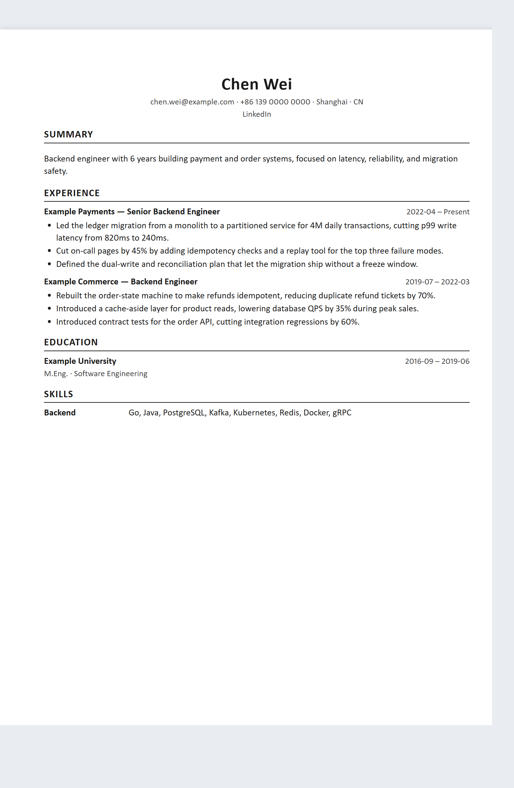
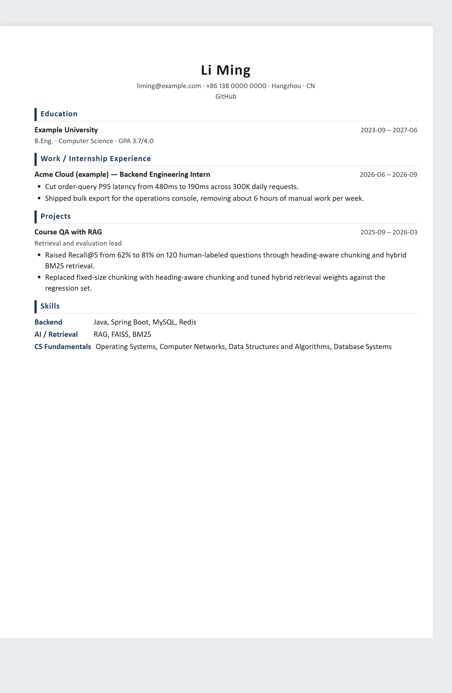
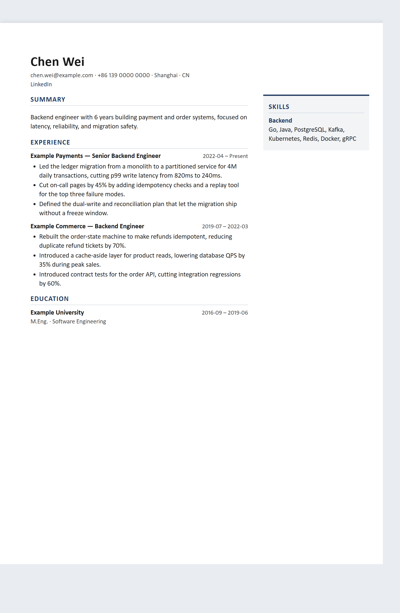
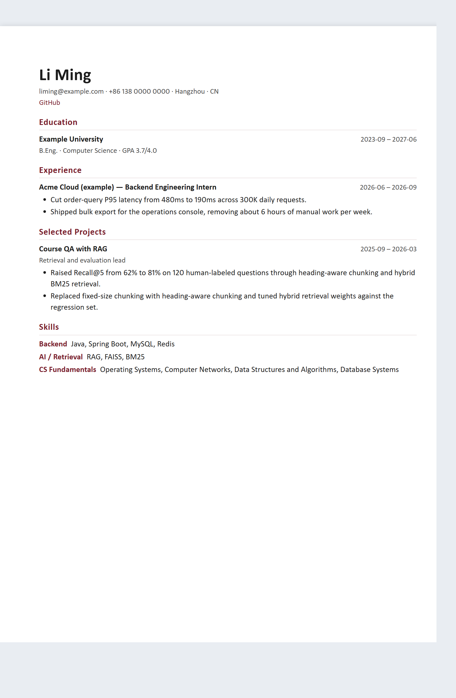
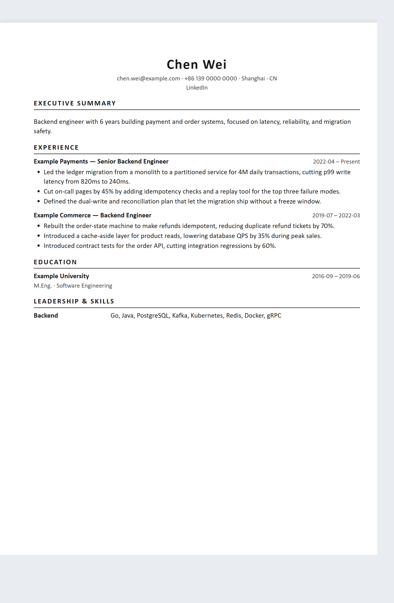

<!-- SPDX-License-Identifier: MIT -->

# Resume Pro Skill

[](LICENSE)
[](README.md)
[](README.en.md)
[](#documentation)

**Get the facts right. Then make the resume work.**

A **China-first resume skill with international support**, combining an agent's guided intake and writing with a Python CLI's validation and rendering. Create, improve, tailor, and localize resumes from a shared record of career facts.

No invented experience, no one-shot generic prose, and no treating Chinese and English resumes as sentence-by-sentence translations. Resume deliverables are **HTML only**, with an **A4** print layout.

## What it does

| Your goal | Workflow |
|---|---|
| Create a resume from scratch | Collect information in stages, check sufficiency, and ask for missing details |
| Improve an existing resume | Extract facts, ask for confirmation, and assess whether to keep or replace the template |
| Understand what needs fixing | Diagnose without silently rewriting |
| Tailor to a role | Select experience against a job description (JD) and report matches, gaps, and risks |
| Explore suitable roles | Recommend role families from existing experience and identify evidence to add |
| Switch between Chinese and English | Reorganize facts and wording for the target market |
| Change the layout or add a photo | Preserve facts; optional photo slots disappear when unused |

Supports students, interns, new graduates, career switchers, experienced professionals, and other personas. China-first by default: `cn_internet` and other Chinese-market profiles lead, while `intl_en` remains available for international applications; see the [market matrix](docs/market-matrix.md) for each profile's scope.

## Core principles

- **Facts and evidence first.** Resume bullets link to sources, distinguishing verified, user-asserted, estimated, and unknown information. Numeric claims supported only by estimated or unknown sources are blocked by checks; a user assertion is not external verification.
- **Guide before generating.** Missing input must be collected one question at a time through the agent's interactive question tool, continuing the same conversation and task after each answer instead of ending with "reply with your answers". Preserve free-text input, pause, and resume. Ask about mass versus targeted applications before selecting experience. If the host lacks a suitable tool, report the limitation rather than silently falling back to a questionnaire.
- **Writing frameworks require consent.** Ask before applying STAR, XYZ, FAB, CAR, result-first, or user-voice guidance.
- **Different markets, different priorities.** Adjust sections, order, page budgets, and photo policies by market and career stage. Chinese campus profiles emphasize education, fundamentals, real internships, and individual project contributions.
- **Order by HR priority.** Student and campus resumes: education → experience → projects → skills. Professional resumes: experience → projects → education → skills.
- **HTML, A4.** Deliver self-contained HTML. Users can print to PDF in their browser with A4 selected.
- **Separate automated checks from judgment.** The CLI checks structure, evidence rules, templates, and output. The agent and user handle wording, fact confirmation, and final review.

## Quickstart

### 1. Prepare the environment

Requires **Python 3.10+**. Run from the repository root:

```bash
python -m pip install -e .
resume --version
resume --help
```

Editable installation lets the CLI read templates, profiles, and schemas directly from the source directory. Keep that directory after installation; downloading dependencies may require network access on first install.

- Install Edge, Chrome, or Chromium for browser-backed layout QA. When unavailable, some checks fall back to estimates and emit a warning.
- Legacy DOC / RTF ingestion requires LibreOffice.
- To use an agent, load this project as a skill with [SKILL.md](SKILL.md) as its entry point. The agent must be able to run local commands; importing a skill does not establish that Python dependencies are ready. See [installation](docs/install.md).

You can also import the packaged skill. Run `python scripts/package_skill.py` to create `dist/resume-pro-skill-<version>.zip`, unzip it, then run `python bootstrap.py` to check the runtime or `python bootstrap.py --install` to add the `resume` command. Without package installation, use `python resume.py`. The archive excludes `docs/local/`, private template candidates, local workspaces, and caches. See [installation](docs/install.md).

### 2. Collect career information

This example targets Chinese internet-sector campus / internship applications. Run in a separate job-application working directory:

```bash
resume init --market cn_internet --persona student_with_internship
resume intake
resume check
resume profile
```

Answer the guided questions. If checks report missing information, fill the gaps before generating; do not bypass a blocked gate. Data is stored under `.resume/` in the current working directory.

### 3. Choose a writing approach and build

Use `--framework result_first` below only after the user agrees to that framework, or replace it with their chosen alternative.

```bash
resume new --role "Backend Engineer" --market cn_internet --persona student_with_internship --framework result_first
```

Replace `<slug>` below with the application identifier returned by the previous command. Confirm the content, then check and build:

```bash
resume lint --app <slug>
resume build <slug> --yes
resume audit <slug>
```

`--yes` confirms acceptance of a minimally sufficient profile; it cannot bypass a blocked gate or other hard failures. Open the generated HTML to review content and layout. For PDF, use the browser's print function with A4 selected.

### 4. Work with an existing resume or target role

These are independent examples. Replace file paths and `<slug>` with your own inputs:

```bash
# Diagnose an existing resume
resume review resume.pdf --market cn_internet --persona experienced

# Extract information and assess the original template; confirm extracted facts
resume optimize resume.docx --market cn_internet --persona experienced

# Compare against a JD and explore suitable role families
resume match --app <slug> --jd jd.md
resume recommend --app <slug>

# List templates or add an optional photo to an application
resume templates
resume photo portrait.jpg --app <slug>

# Create an English application from the recorded facts
resume localize <slug> --to en --role "Backend Engineer" --yes
```

Localization still reselects and rewrites for the target market, never translates HTML. It retains the source design ID by default; an explicit `--template <id>` overrides it. A private learned template without the target-language variant fails clearly, never silently changes designs; legacy flat templates remain supported with manifest-language validation. The agent and user must supply target-language wording. Missing wording is reported as gaps, not translated or invented by the CLI; failed fact-parity checks block final delivery.

For complete workflows, see the [walkthrough](docs/walkthrough.md) and [CLI contract](docs/cli-contract.md).

## Inputs, templates, and outputs

**Inputs:** DOCX, text-based PDF, HTML, Markdown, and TXT. DOC / RTF require LibreOffice.

**Templates:** **Five distinct designs × two resume languages = 10 variants.** `templates/cn/` and `templates/en/` indicate resume language, with manifest `language: zh` / `en`. Preview screenshots below; click one to open the full HTML.

| Design ID | Preview | 中文 | English |
|---|---|---|---|
| `ats-classic` | <a href="templates/en/ats-classic/preview.html"></a> | [cn](templates/cn/ats-classic/) | [en](templates/en/ats-classic/) |
| `campus` | <a href="templates/en/campus/preview.html"></a> | [cn](templates/cn/campus/) | [en](templates/en/campus/) |
| `modern-sidebar` | <a href="templates/en/modern-sidebar/preview.html"></a> | [cn](templates/cn/modern-sidebar/) | [en](templates/en/modern-sidebar/) |
| `editorial` | <a href="templates/en/editorial/preview.html"></a> | [cn](templates/cn/editorial/) | [en](templates/en/editorial/) |
| `executive` | <a href="templates/en/executive/preview.html"></a> | [cn](templates/cn/executive/) | [en](templates/en/executive/) |

Rendering and QA resolve the variant using the application's `writing.locale`, falling back to the market profile's `language`; missing or mismatched variants fail explicitly. Default recommendations are `campus` / `modern-sidebar` for Chinese-market campus / professional profiles and `ats-classic` / `executive` for international default / senior profiles.

**Viewing and choosing:** Open `templates/<cn|en>/<id>/preview.html` in a browser to preview each layout; `resume templates` lists every variant with its preview path. When building a resume, the agent asks which layout to use through an interactive question before rendering — recommending the default but allowing a change — and points to those previews. It never silently accepts the default when you have not been asked.

Restyling changes appearance only, not market, selection, or writing locale. Market and persona still govern selection, writing, page policy, photos, and fact confirmation. Each layout's capacity budgets and fixed two-column regions remain binding; see the [template contract](docs/template-contracts.md). Photo slots collapse completely when unused; `intl_en` suppresses photos by market policy regardless of design or resume language. Bilingual coverage does not change template review status. Review each layout with actual content; automated checks are not design approval or a guarantee of compatibility with every ATS.

**Outputs:** Final HTML, a non-canonical editable HTML copy, and check reports. Targeted applications normally include the role in the file name. Browser edits to the editable copy are not automatically merged back into the career vault.

## How it works

```text
Guided intake → sufficiency gate → market/persona profile → fact selection
              → application model → writing + lint → optional localization → HTML → QA
```

- **Career vault:** Durable experience, evidence records, and per-language wording.
- **Application model:** Fact selections, target market, writing settings, and template for one application.
- **Template contract:** Slots and content requirements declared with `data-slot`, filled by a deterministic renderer.

The CLI processes data locally, with no telemetry or automatic upload feature. Whether the agent's model provider receives conversation or file content depends on your client and model configuration; this does not make the entire workflow offline.

## Documentation

Detailed technical documentation is currently primarily in English. The language links above switch only the project README.

| Document | Contents |
|---|---|
| [Installation](docs/install.md) | Environment requirements and Skill / CLI setup |
| [Quickstart](docs/quickstart.md) | Guided intake, checks, and common commands |
| [Walkthrough](docs/walkthrough.md) | Complete an application by scenario |
| [Agent entry](SKILL.md) | Triggers, workflows, and non-negotiable rules |
| [Market matrix](docs/market-matrix.md) | Market and persona coverage |
| [Chinese resume rules](docs/cn-resume-rules.md) | Content and structure for Chinese-market resumes |
| [Intake and sufficiency](docs/intake-and-sufficiency.md) | Follow-up questions and generation gates |
| [Writing engine](references/writing-engine.md) | Frameworks, wording, and evidence constraints |
| [Triggers and routes](docs/triggers-and-routes.md) | Handling different user intents |
| [CLI contract](docs/cli-contract.md) | Commands, inputs, outputs, and exit codes |
| [Template contracts](docs/template-contracts.md) | Slots, budgets, and template rules |
| [Evaluation and limitations](docs/evaluation.md) | Tests, QA, and ATS-check boundaries |
| [Open-source policy](docs/open-source-policy.md) | Rules for code, templates, and assets |

## Development and verification

```bash
python -m pip install -e ".[dev]"
python -m pytest
```

The public suite covers the vault, evidence rules, intake, ingestion, selection, templates, rendering, localization, and QA. Passing tests do not certify hiring outcomes, universal ATS compatibility, or upstream code provenance.

Read [CONTRIBUTING.md](CONTRIBUTING.md) before contributing.

## License

This project uses the [MIT License](LICENSE). See [ATTRIBUTIONS.md](ATTRIBUTIONS.md) for prior art and license notes. Third-party content remains subject to its own licenses.
