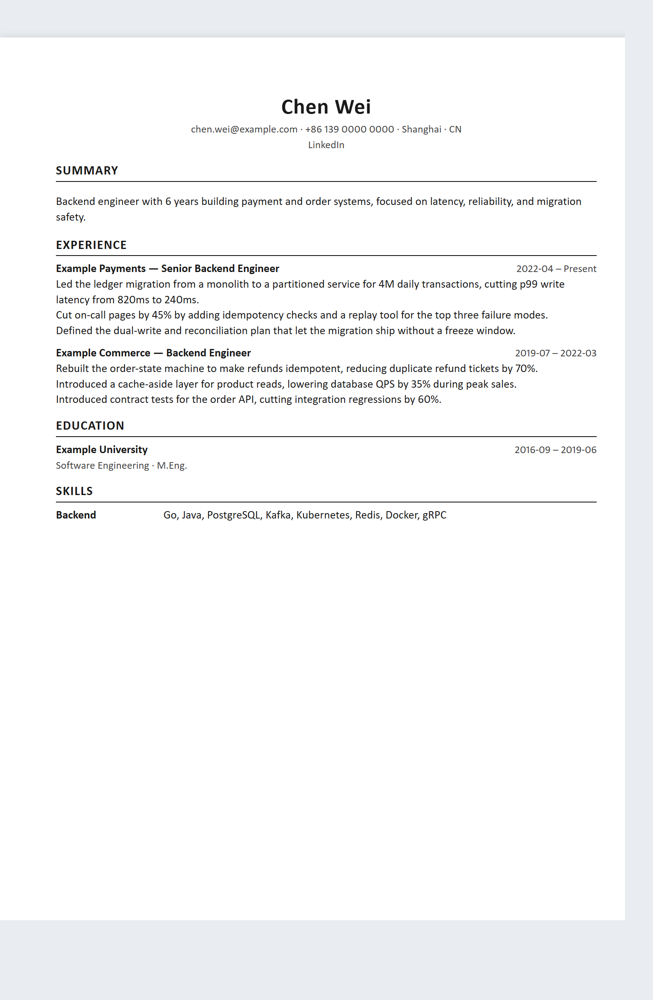
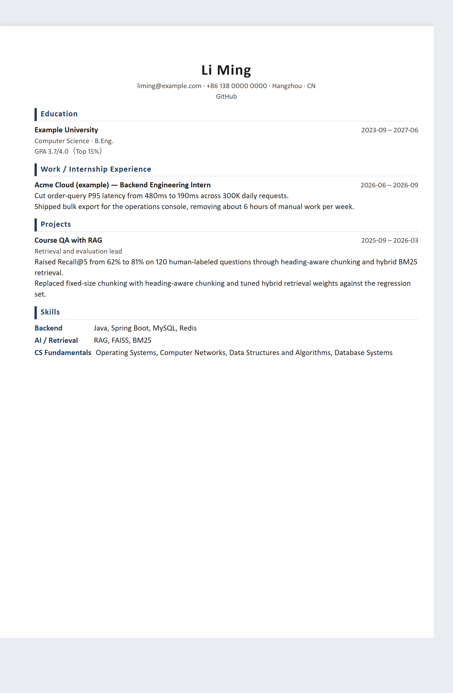
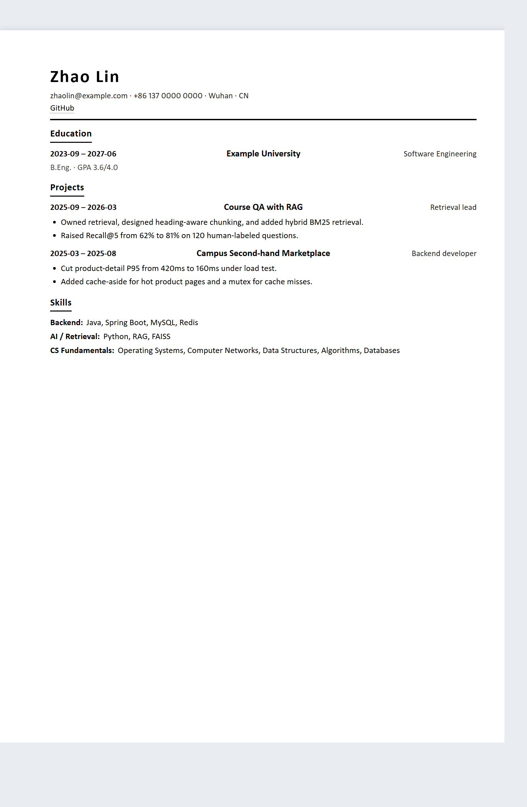
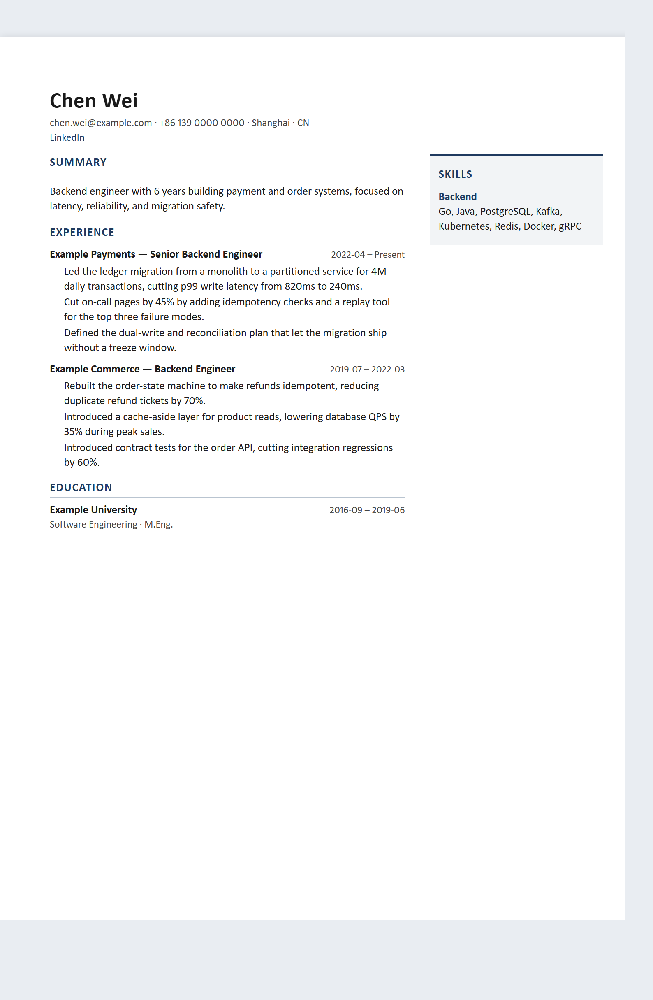
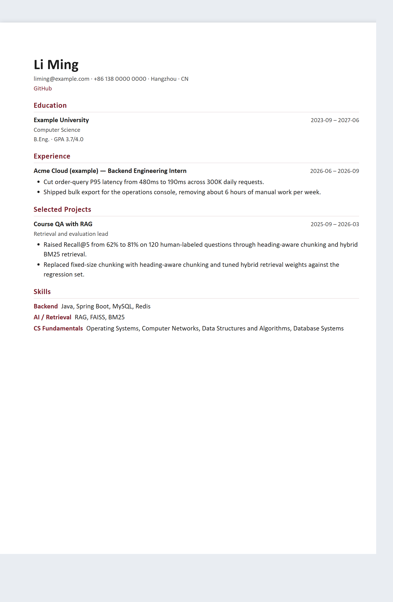
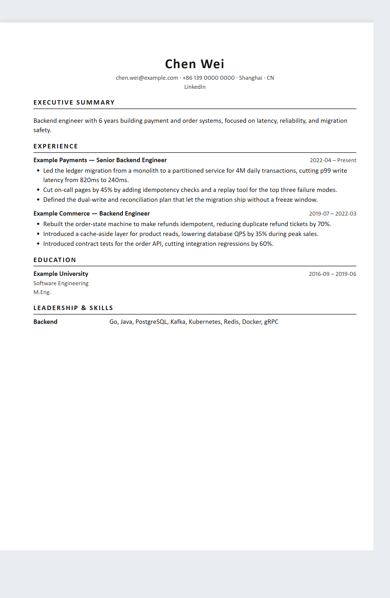

<!-- SPDX-License-Identifier: MIT -->

# Resume Pro Skill

[](LICENSE)
[](README.md)
[](README.en.md)
[](#文档)

**先问清事实，再写好简历。**

**主要聚焦中国求职市场、同时兼顾国际求职场景**的简历 Skill，结合 Agent 的引导与写作能力，以及 Python CLI 的校验与渲染能力，帮助用户从零制作、优化、定向调整和中英文本地化简历。

不编造经历，不一键堆砌套话，也不把中英文简历当作简单的逐句翻译。简历交付格式仅为 **HTML**，使用 **A4** 打印布局。

## 能做什么

| 你的需求 | 工作方式 |
|---|---|
| 从零制作简历 | 分步收集信息，检查是否足够，再追问缺失内容 |
| 优化已有简历 | 提取事实，请用户确认，评估并选择保留或更换模板 |
| 只想知道问题 | 提供诊断，不擅自改写 |
| 针对岗位调整 | 对照职位描述（JD）选择经历，分析匹配点、缺口与风险 |
| 不确定适合什么岗位 | 根据已有经历推荐岗位方向，指出需要补充的证据 |
| 中英文简历转换 | 基于同一份事实，按目标市场重新组织内容与表达 |
| 更换模板或添加照片 | 保留事实；照片可选，不设置时不留下占位框 |

面向学生、实习生、应届生、转行者、有经验的求职者等不同人群。默认以中国求职市场为主：`cn_internet` 等中文市场配置优先，同时保留 `intl_en` 用于国际场景；各市场配置的适用范围见[市场矩阵](docs/market-matrix.md)。

## 核心原则

- **事实与证据优先。** 简历要点关联来源，区分已核实、用户自述、估计和未知信息。只有估计或未知来源支撑的数字会被检查拦截；用户自述不等于外部核实。
- **先引导，再生成。** 信息不足时必须通过 Agent 的交互式提问工具逐项追问，收到答案后继续同一会话中的任务，不以“请回复答案”结束执行；支持自由输入、暂停和续答。先询问海投还是定向投递，再决定如何选择经历。宿主未提供可用的交互工具时，会说明限制，而不是悄悄退回问卷式回复。
- **写作框架由用户选择。** 使用 STAR、XYZ、FAB、CAR、结果优先或保留个人语气前，先获得同意。
- **不同市场，不同重点。** 按市场与求职阶段调整栏目、顺序、页数和照片策略；中文校园场景强调教育、基础技能、真实实习与项目贡献。
- **按 HR 重点排序。** 学生与校招简历：教育经历 → 实习经历 → 项目经历 → 专业技能；职场简历：工作经历 → 项目经历 → 教育经历 → 专业技能。
- **HTML，A4。** 输出自包含 HTML；需要 PDF 时由用户在浏览器中选择 A4 打印。
- **规则校验与人工判断分工。** CLI 负责结构、证据规则、模板和输出检查；Agent 与用户负责表达质量、事实确认和最终审阅。

## 快速开始

### 1. 准备运行环境

需要 **Python 3.10+**。在本项目根目录执行：

```bash
python -m pip install -e .
resume --version
resume --help
```

这里使用可编辑安装，让 CLI 直接读取源码目录中的模板、规则和 Schema。安装后请保留该目录；首次安装依赖可能需要联网。

- 安装 Edge、Chrome 或 Chromium，可启用浏览器辅助的排版 QA；不可用时部分检查退回估算并给出警告。
- 导入旧版 DOC / RTF 文件需要 LibreOffice。
- 使用 Agent 时，将本项目作为 Skill 加载，入口为 [SKILL.md](SKILL.md)。Agent 需要能够运行本地命令；导入 Skill 不代表 Python 依赖已经就绪。具体配置见[安装说明](docs/install.md)。

也可以导入打包后的 Skill：执行 `python scripts/package_skill.py` 生成 `dist/resume-pro-skill-<version>.zip`，解压后运行 `python bootstrap.py` 检查环境，或用 `python bootstrap.py --install` 安装 `resume` 命令；无法安装依赖时用 `python resume.py` 启动。归档会排除 `docs/local/`、私有模板候选、本地工作区与缓存。详见[安装说明](docs/install.md)。

### 2. 从零建立简历资料

以下以中文互联网校招 / 实习场景为例。在独立的求职工作目录执行：

```bash
resume init --market cn_internet --persona student_with_internship
resume intake
resume check
resume profile
```

按引导回答问题。检查发现缺项时，先补充信息，不要跳过阻断直接生成。资料保存在当前工作目录的 `.resume/` 中。

### 3. 选择写作方式并生成

仅在用户同意结果优先框架后使用下面的 `--framework result_first`；也可以换成用户选择的其他框架。

```bash
resume new --role "Backend Engineer" --market cn_internet --persona student_with_internship --framework result_first
```

将下面的 `<slug>` 替换为上一条命令返回的申请标识。确认内容后检查并构建：

```bash
resume lint --app <slug>
resume build <slug> --yes
resume audit <slug>
```

`--yes` 用于确认仅达到最低充分度的资料，不能绕过信息不足或其他硬性失败。打开生成的 HTML 检查内容与布局；需要 PDF 时使用浏览器的 A4 打印功能。

生成的文件会同步到 `workspace/<slug>/`，简历、可编辑副本和报告放在同一个项目文件夹中；简历诊断也放在 `workspace/` 下。

### 4. 已有简历或目标岗位

下面是独立的使用示例，文件路径和 `<slug>` 需替换为自己的输入：

```bash
# 诊断已有简历
resume review resume.pdf --market cn_internet --persona experienced

# 提取资料并评估原模板；仍需用户确认提取结果
resume optimize resume.docx --market cn_internet --persona experienced

# 对照 JD 分析匹配情况，并推荐岗位方向
resume match --app <slug> --jd jd.md
resume recommend --app <slug>

# 查看模板，或为申请添加可选照片
resume templates
resume photo portrait.jpg --app <slug>

# 基于事实创建英文版本
resume localize <slug> --to en --role "Backend Engineer" --yes
```

本地化仍按目标市场重新选材与写作，不翻译 HTML；默认保留来源版式 ID，显式 `--template <id>` 可覆盖。私有 learned 模板若无目标语言版本会明确报错，不静默换版式；旧式平铺模板仍兼容，但须校验 manifest 语言。Agent 与用户需要补齐目标语言的表达；缺少内容时 CLI 报告缺口，不自行翻译或编造，事实一致性检查失败会阻止正式交付。

更完整的操作见[使用演练](docs/walkthrough.md)和 [CLI 契约](docs/cli-contract.md)。

## 输入、模板与输出

**输入：** DOCX、文本型 PDF、HTML、Markdown、TXT；DOC / RTF 需要 LibreOffice。

**模板：** 提供 **6 种不同设计 × 中英双语，共 12 个变体**。`templates/cn/` 与 `templates/en/` 仅表示简历语言，manifest 分别为 `language: zh` / `en`。下表为各模板的预览截图，点击图片可打开完整 HTML。

| 设计 ID | 预览 |
|---|---|
| `ats-classic` | <a href="templates/en/ats-classic/preview.html"></a> |
| `campus` | <a href="templates/en/campus/preview.html"></a> |
| `compact` | <a href="templates/en/compact/preview.html"></a> |
| `modern-sidebar` | <a href="templates/en/modern-sidebar/preview.html"></a> |
| `editorial` | <a href="templates/en/editorial/preview.html"></a> |
| `executive` | <a href="templates/en/executive/preview.html"></a> |

渲染与 QA 按申请的 `writing.locale` 选语言变体，未设置时使用市场 profile 的 `language`；缺失或语言不匹配会明确报错。默认推荐为中文市场校园 / 职场的 `campus` / `modern-sidebar`、国际市场常规 / 高阶的 `ats-classic` / `executive`。

**查看与选择：** 在浏览器打开 `templates/<cn|en>/<id>/preview.html` 即可预览每个版式；`resume templates` 会列出全部变体及其预览路径。制作简历时，Agent 会在渲染前用交互式提问询问你选用哪个版式（给出默认推荐但可改选），并告知上述预览入口，不会在你未表态时静默采用默认。

更换版式只改变外观，不改市场、选材或写作语言。市场与 persona 仍决定选材、写作、页数、照片和事实确认规则；各布局的容量预算与双栏固定区域仍有效，详见[模板契约](docs/template-contracts.md)。照片插槽在未设置照片时完全收起；`intl_en` 按市场策略不显示照片，不受版式或简历语言影响。此次双语补齐不改变模板审核状态；模板效果仍需结合实际内容人工审阅，自动检查不代表设计审核或所有 ATS 的兼容性保证。

**输出：** 正式 HTML、非权威的可编辑 HTML 副本，以及检查报告。定向申请通常在文件名中包含岗位。浏览器中对可编辑副本的修改不会自动写回事实库。

## 工作原理

```text
引导收集 → 充分度检查 → 市场与人群配置 → 事实选择
        → 申请模型 → 写作与检查 → 可选本地化 → HTML 渲染 → QA
```

- **事实库（vault）**：保存长期经历、证据记录和不同语言的措辞。
- **申请模型（application）**：保存某次申请的事实选择、目标市场、写作设置和模板。
- **模板契约**：通过 `data-slot` 声明插槽和内容要求，由确定性渲染器填充。

CLI 在本地处理资料，不提供遥测或自动上传功能。Agent 所使用的模型服务是否接收对话或文件内容，取决于你的客户端与模型配置，不能据此视为整个工作流完全离线。

## 文档

详细技术文档目前主要使用英文；此处的语言切换仅切换项目 README。

| 文档 | 内容 |
|---|---|
| [安装说明](docs/install.md) | 环境要求与 Skill / CLI 配置 |
| [快速开始](docs/quickstart.md) | 引导收集、检查与常用命令 |
| [使用演练](docs/walkthrough.md) | 按场景完成一次申请 |
| [Agent 入口](SKILL.md) | 触发条件、工作流程与不可违反的规则 |
| [市场矩阵](docs/market-matrix.md) | 市场与人群配置的适用范围 |
| [中文简历规则](docs/cn-resume-rules.md) | 中文场景的内容与结构要求 |
| [信息收集与充分度](docs/intake-and-sufficiency.md) | 追问逻辑与生成门槛 |
| [写作引擎](references/writing-engine.md) | 框架、措辞与证据约束 |
| [触发与路由](docs/triggers-and-routes.md) | 不同用户意图的处理方式 |
| [CLI 契约](docs/cli-contract.md) | 命令、输入输出与退出码 |
| [模板契约](docs/template-contracts.md) | 插槽、预算与模板规则 |
| [评估与限制](docs/evaluation.md) | 测试、QA 与 ATS 检查边界 |
| [开源政策](docs/open-source-policy.md) | 代码、模板与素材的使用原则 |

## 开发与验证

```bash
python -m pip install -e ".[dev]"
python -m pytest
```

公开测试覆盖事实库、证据规则、信息收集、导入、选择、模板、渲染、本地化与 QA 等模块。测试通过不等于真实招聘效果、所有 ATS 兼容性或上游代码来源已经得到认证。

贡献前请阅读 [CONTRIBUTING.md](CONTRIBUTING.md)。

## License

本项目采用 [MIT License](LICENSE)。参考项目与相关许可说明见 [ATTRIBUTIONS.md](ATTRIBUTIONS.md)；第三方内容仍受其各自许可约束。
